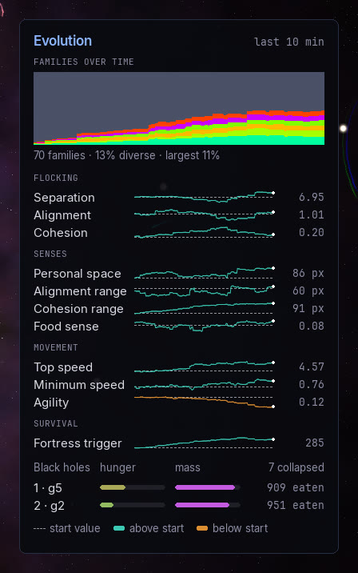

# Selection Pressure

[](https://github.com/burakkagann/selection-pressure/actions/workflows/ci.yml)
[](https://www.python.org)
[](LICENSE)

> Emergent flocking under gravitational threat.


Stars flock, black holes hunt them, and the survivors pass their traits on. Over a few minutes you can watch the population evolve. A real-time generative artwork in Python, first shown as a wall projection at the *Pixels2GenAI* exhibition (2026).

## Run it

Python 3.10+ on Windows, macOS or Linux.

```bash
git clone https://github.com/burakkagann/selection-pressure.git
cd selection-pressure
pip install .
selection-pressure
```

A window opens at 80% of your screen. Press `H` for the controls.

| View | | World | | Make | |
|---|---|---|---|---|---|
| `I` | Evolution panel | `Space` | Pause | `S` | Screenshot |
| `H` | Controls | `R` | Restart | `G` | Black hole tuning |
| `F` | Fullscreen | `+` `-` | More or fewer stars | `D` | Print tuning values |
| `M` | Black hole style | `]` `[` | Add or remove a black hole | `Esc` | Quit |

Useful options: `--fullscreen`, `--stars N`, `--black-holes N` (up to 3), `--seed N`, `--display auto` (a projector), and `--kiosk` for the exhibition setup, which starts with a sparse sky and fills it over a few hours. `selection-pressure --help` lists them all.

## What you are watching

- **Flocking.** Each star follows Craig Reynolds' three boid rules: keep apart, align, stay together.
- **Black holes.** They chase the flock, grow as they feed and collapse if they starve, scattering new stars. Each is a GPU particle disk orbiting a dark centre; press `M` for the 2D look, used on its own where OpenGL 3.3 is missing.
- **Food and fortresses.** Stars burn energy and refuel only in nebula clouds. When enough crowd together they form a fortress that saves energy but holds them in place.
- **Evolution.** Every star carries its own genes for those behaviours. The survivors breed, so the flock slowly adapts to whatever the black holes are doing.



The **strip** along the bottom shows the largest families of related stars, four key genes and each black hole's hunger and mass. Press `I` for the **timeline**: how families rise and die out, and how every gene has drifted from its starting value (dashed line) over the last ten minutes. Teal means a gene evolved upward, amber downward.

<br clear="right">

## Record a clip

With [ffmpeg](https://ffmpeg.org/) installed, the piece renders itself offline, at full quality and any size:

```bash
selection-pressure --preset readme --record demo.gif   # 16:9 GIF with the strip, like the one above
selection-pressure --preset reddit --record art.mp4    # 4:5 for phone feeds
selection-pressure --preset reel   --record reel.mp4   # 9:16 for Reels, TikTok, Shorts
selection-pressure --preset wide   --record wide.mp4   # 16:9 with the timeline
```

Presets warm the simulation up first, so the clip starts mid-story. `--size`, `--duration`, `--warmup` and `--panel strip|full` override them.

## Make it your own

Almost everything is a commented constant in [config.py](src/selection_pressure/config.py): flock rules, black hole appetite, mutation rates, colours. The black hole disks can be tuned live with `G`. [docs/DEVELOPMENT.md](docs/DEVELOPMENT.md) covers the architecture, tests and known limitations.

## Credits

**Burak Kagan Yilmazer**, 2026, for the *Pixels2GenAI* exhibition. Released under the [MIT License](LICENSE).

- The black hole particle disks are adapted from [lechebs/nbody](https://github.com/lechebs/nbody) by Luca Ballone (MIT).
- Flocking after Craig W. Reynolds, *Flocks, Herds, and Schools: A Distributed Behavioral Model* (SIGGRAPH 1987).
- Panels set in [Inter](https://github.com/rsms/inter) and [JetBrains Mono](https://github.com/JetBrains/JetBrainsMono) (SIL Open Font License).

Full licence texts are in [THIRD_PARTY_NOTICES.md](THIRD_PARTY_NOTICES.md).
