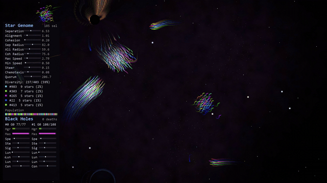

# Selection Pressure

[](https://github.com/burakkagann/selection-pressure/actions/workflows/ci.yml)
[](https://www.python.org)
[](LICENSE)

> Emergent flocking under gravitational threat.



A real-time generative-art simulation written in Python. Stars swarm, black holes hunt, and an evolutionary algorithm running beneath the surface selects for survival. Originally shown as a wall-projection installation in the *Pixels2GenAI* exhibition (2026).

---

## Table of Contents

- [Overview](#overview)
- [Features](#features)
- [Installation](#installation)
- [Usage](#usage)
- [Recording a clip](#recording-a-clip)
- [Configuration](#configuration)
- [Architecture](#architecture)
- [Development](#development)
- [Known Quirks & Limitations](#known-quirks--limitations)
- [License](#license)
- [Credits](#credits)

---

## Overview

Selection Pressure is built on three rules drawn from Craig Reynolds' 1987 boid flocking model: separate from neighbours, align with their heading, steer toward the group centre. On top of that foundation sit several interacting systems that push the flock around and give the viewer something to watch on a long timescale.

The piece was designed to run for hours on a single boot. It starts with 50 stars and grows to roughly 800 over the first three hours, then holds at full intensity. A small audience interaction is exposed through the `[` and `]` keys, which add or remove black holes between 1 and 3.

## Features

- **Boid flocking** with evolvable per-star parameters (separation, alignment, cohesion weights, and more).
- **Black-hole predators** with gravitational lensing, photon spheres, and accretion glow. Their mass grows when they feed and decays when they starve; a predator that starves explodes into new stars and respawns with mutated traits.
- **Nebula resource fields.** Stars carry an internal energy value that depletes over time and replenishes only inside a nebula patch. Food becomes a reason to move.
- **Quorum sensing.** When local density crosses a threshold, stars shift into a defensive "fortress" mode that halves their energy drain but holds them in place. Hungry stars eventually break formation to forage.
- **Evolutionary algorithm.** Survivors pass their behavioural weights to the next generation through tournament selection and uniform crossover. Lineages are visible in the evolution panel (bottom-left).
- **Age-coloured trails** that shift from warm to cool as they persist, revealing the social forces shaping the flock.

## Installation

Requires Python 3.10 or newer. It runs on Windows, macOS and Linux; multi-monitor placement is most precise on Windows.

```bash
git clone https://github.com/burakkagann/selection-pressure.git
cd selection-pressure
python -m venv .venv
# Windows: .venv\Scripts\activate    macOS / Linux: source .venv/bin/activate
pip install .
```

With [uv](https://docs.astral.sh/uv/) you can instead run `uv sync` to get the exact dependency versions from `uv.lock`.

## Usage

```bash
selection-pressure                 # borderless fullscreen on the primary monitor
selection-pressure --windowed      # resizable window (80% of the monitor)
selection-pressure --display auto  # largest secondary screen, e.g. a projector
python -m selection_pressure       # same as the command above
```

Useful options (see `selection-pressure --help` for all of them):

| Option | Meaning |
|---|---|
| `--display primary\|auto\|N` | Which monitor to use (`SP_DISPLAY` env var also works) |
| `--windowed [WxH]` | Run in a window, optionally with an exact size |
| `--stars N`, `--black-holes N` | Starting population (10-2000 stars, 0-3 black holes) |
| `--seed N` | Random seed; the same seed gives the same run |
| `--no-hud` | Hide the status line, clock and visitor hint |
| `--kiosk` | Exhibition mode: minimise the console window on start |
| `--screenshot-dir DIR` | Where `S` saves screenshots (default: current directory) |
| `--frames N`, `--profile` | Quit after N frames; print per-stage frame timings |

### Controls

| Key         | Action                         |
|-------------|--------------------------------|
| `ESC` / `Q` | Quit                           |
| `SPACE`     | Pause / resume                 |
| `R`         | Reset simulation               |
| `F`         | Toggle fullscreen              |
| `H`         | Toggle help overlay            |
| `S`         | Save screenshot (`sp_screenshot_NNN.png`, never overwrites) |
| `+` / `-`   | Add / remove stars (50 at a time) |
| `[` / `]`   | Add / remove black holes (1-3) |

## Recording a clip

With [ffmpeg](https://ffmpeg.org/) on your `PATH`, the piece can render itself offline to a video or GIF. Frames are produced as fast as your machine allows and encoded at a steady frame rate, so the result is smooth even where live playback is not.

```bash
# 40 seconds of 1080p video after a 25-second warm-up
selection-pressure --windowed 1920x1080 --no-hud --warmup 25 --duration 40 --record clip.mp4

# a short GIF (at most 720 px wide, 20 fps)
selection-pressure --windowed 1280x720 --no-hud --duration 8 --record clip.gif
```

The demo at the top of this page was made this way (400 stars, 2 black holes).

## Configuration

Behavioural and visual tuning lives in [src/selection_pressure/config.py](src/selection_pressure/config.py). The file is sectioned by subsystem (boids, predators, nebula, quorum, evolution, visuals) and almost every constant has a comment with a suggested range. Edit, save and re-run.

A few defaults worth knowing:

| Constant                | Default | Meaning                                    |
|-------------------------|---------|--------------------------------------------|
| `NUM_BOIDS`             | 50      | Starting star count (also `--stars`)       |
| `POPULATION_TARGET`     | 800     | Population cap, reached after ~3 hours     |
| `TARGET_FPS`            | 60      | Simulation is tuned per frame at 60 fps    |
| `EVOLUTION_ENABLED`     | `True`  | Turn the genetic algorithm on/off          |
| `NEBULA_FIELDS_ENABLED` | `True`  | Enable the foraging layer                  |
| `QUORUM_ENABLED`        | `True`  | Enable fortress mode                       |

Every `*_ENABLED` switch can be turned off on its own; the test suite runs the full pipeline with each one disabled.

## Architecture

All runtime code is in [src/selection_pressure/](src/selection_pressure/):

| Module          | Role                                                                    |
|-----------------|-------------------------------------------------------------------------|
| `cli.py`        | Command-line options, turned into an `app.Options`                      |
| `app.py`        | `App`: window, input, the per-frame pipeline and the main loop          |
| `simulation.py` | Boid physics, predator behaviour, evolution, quorum (pure NumPy, no pygame) |
| `nebula.py`     | `NebulaField`: resource patch positions, density, depletion, regeneration |
| `rendering.py`  | Trails, boids, black-hole effects, bloom, gravitational lensing         |
| `hud.py`        | Text overlays: status line, clock, evolution panel, help                |
| `background.py` | Procedural galaxy background, generated once at startup                 |
| `display.py`    | Monitor discovery and Windows DPI / console helpers                     |
| `recorder.py`   | Offline MP4 / GIF capture through ffmpeg                                |
| `config.py`     | All tunable parameters                                                  |

Each frame the app steps the predators and `BoidsSimulation`, draws into a persistent trail surface (which fades a little every frame), composites it over the background, then adds bloom, lensing and the overlays. The simulation has no pygame dependency and can run headless, which is how most of the tests exercise it.

## Development

```bash
pip install -e ".[dev]"
pre-commit install          # ruff lint + format and basic hygiene on every commit
pytest                      # headless; uses SDL's dummy video driver
```

The suite covers the simulation invariants, every feature switch, the CLI, the key bindings, recording, and a numerical regression check against `tests/data/golden.npz`. After an intentional behaviour change, regenerate it with `python tests/update_golden.py` and commit the new file with the change.

CI runs the tests on Linux, Windows and macOS for Python 3.10-3.13 on every push and pull request, and again weekly to catch breakage from new dependency releases.

## Known Quirks & Limitations

Things worth knowing if you fork, modify, or run this on unfamiliar hardware:

- **Shared predator starvation window.** When any predator starves and respawns, *all* predators' kill counts reset. This was fine in the exhibition (predators evaluate as a cohort) but can feel unfair if you add more predators or run long ablations.

- **No save/load.** Each launch is a fresh simulation. There's no checkpoint for the evolved genome or predator state; the exhibition expected a clean start on every boot.

- **No audio.** The piece is silent by design.

- **Fullscreen is borderless**, not exclusive. It stays visible when another screen has focus (useful with a projector), but on a single monitor the mouse can still reach other windows.

- **Monitor positions on macOS and Linux.** Without the Windows API the piece knows each monitor's size but not its desktop position, so `--display` may place a borderless window on the wrong screen. `--windowed` always works.

- **Performance scales with star count squared.** The neighbour-distance matrix is O(n²) and becomes the bottleneck around 1000+ stars. `POPULATION_TARGET = 800` keeps a mid-range machine near 60 fps; use `--profile` to see where the time goes.

## License

Released under the [MIT License](LICENSE).

## Credits

**Burak Kagan Yilmazer**, 2026. Created for the *Pixels2GenAI* exhibition.

The flocking model is based on Craig W. Reynolds, *Flocks, Herds, and Schools: A Distributed Behavioral Model* (SIGGRAPH 1987).
